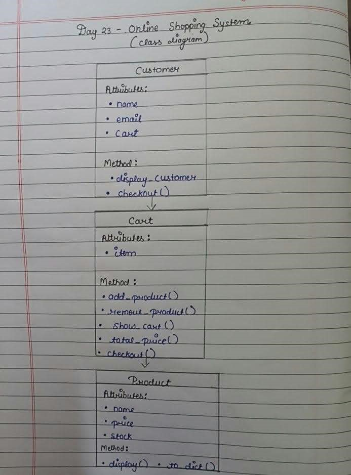

# Class Diagram

 Day 23

## What is does

- product.py:– Stores product details.
- cart.py:– Manages cart items and total price.
- customer.py:– Stores customer details and manages the cart.
- main.py: Runs the shopping program.
- shop_data.json:– Stores shopping data.
# how to run
    open the python files in  VS code and click Python file.   